# BangBar

BangBar turns the MacBook notch into a panel of widgets. Move the pointer onto the notch and the panel slides out with your music, calendar, tasks and habits; move it away and the panel slides back. While music plays, a compact strip stays around the notch with the artwork and a playback indicator.

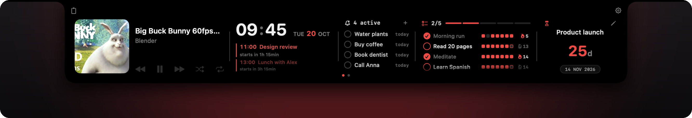

BangBar is a native macOS app written in Swift and SwiftUI. It needs macOS 26.4 or later and works best on a MacBook with a notch; on other displays the panel opens from the top center of the screen.

## What it does

- Thirteen widgets sit on up to two pages, and a two-finger swipe moves between them. You pick which widgets are on, their order and their page.
- Now Playing controls Apple Music and Spotify. For any other app it shows what plays: a YouTube video in a browser appears with its title, channel and preview image.
- The compact strip stays at the notch while music plays, while the focus timer runs, or while you collect images from the clipboard.
- Short notices grow out of the notch when you plug in or unplug the charger, when sound moves to AirPods, and when the volume changes. BangBar can also take over the volume keys, so the system volume HUD stops covering the screen.
- Clipboard history keeps the text and images you copy, with pinned items and image groups, one swipe or click away in the panel.
- The keyboard layout switcher fixes text typed in the wrong layout, for example `ghbdtn` into `привет`, on a hotkey or as you type.
- Meeting alerts cover the screen shortly before a calendar event starts and offer a join button when the event has a meeting link.

### Widgets

| Widget | Shows |
|---|---|
| Now Playing | Track, artwork and playback controls; audio from other apps |
| Clock | Time, date and today's upcoming calendar events |
| Reminders | Open tasks from a list in the Reminders app, overdue first; add and complete tasks |
| Habits | Daily routines with streaks and a completion history |
| Countdown | Time left until a date you pick |
| Day Plans | Plans for today, synced through iCloud Drive |
| Focus Timer | Work and break sessions |
| System | CPU, memory, battery, disk and local IP |
| GitHub | The public contribution graph of a GitHub user |
| AI Usage | Session and weekly quota of Codex and Claude Code |
| Moon | Moon phase, illumination and the next new and full moon |
| Translator | Translation between Russian and English, on device |
| Mirror | A mirrored camera preview |

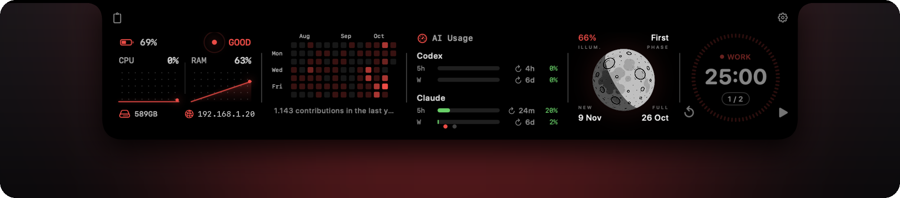

### Compact mode and notices

The compact strip shows what is playing; a browser tab shows its own preview. Volume, charging and Bluetooth notices grow out of the notch for a moment and slide back.

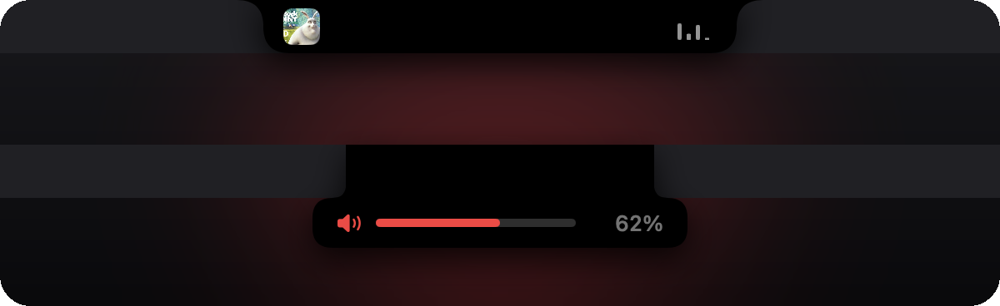

### Gestures

With the panel open, two-finger swipes on the trackpad move around it.

- Swipe down to open clipboard history, and up to return to the widgets. The clipboard button in the panel's top left corner does the same.
- Swipe left or right to switch between page 1 and page 2. The dots at the bottom show the open page; they appear only when page 2 has widgets.

Swipes over a list that scrolls, such as Habits, scroll the list instead. Settings › Widgets › General has Invert page swipe direction; Settings › Clipboard has Swipe navigation, to turn the clipboard swipe off, and Invert swipe direction.

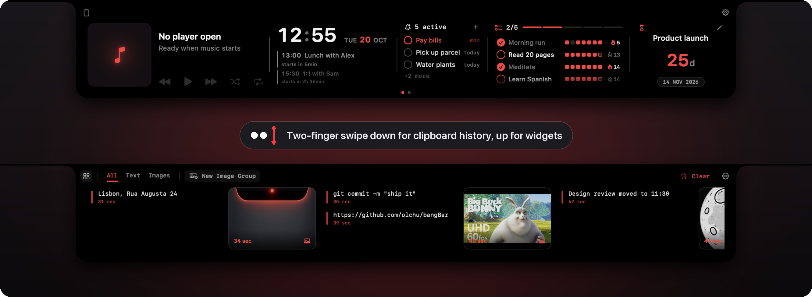

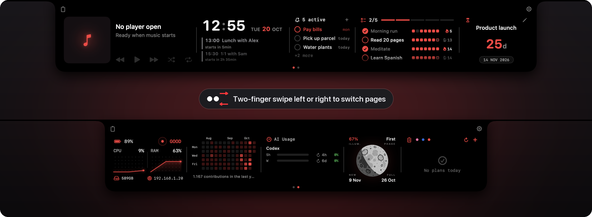

### Reminders

The Reminders widget works on your lists in the macOS Reminders app; BangBar keeps no task list of its own. Pick the list in Settings › Widgets › Reminders, or choose All Reminders to see open tasks from every list. The widget shows up to ten open tasks, overdue ones first and in the accent color, then the rest by due date.

Changes go both ways. A task you add with the + button, or complete by clicking its circle, is saved to Reminders at once. A task you add or complete in Reminders, or on another device that syncs your lists, shows up in the widget as soon as Reminders has it.

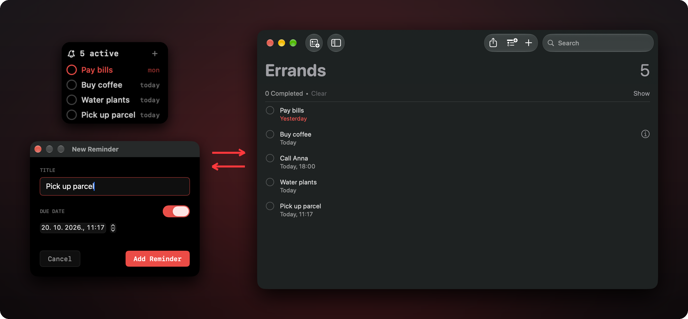

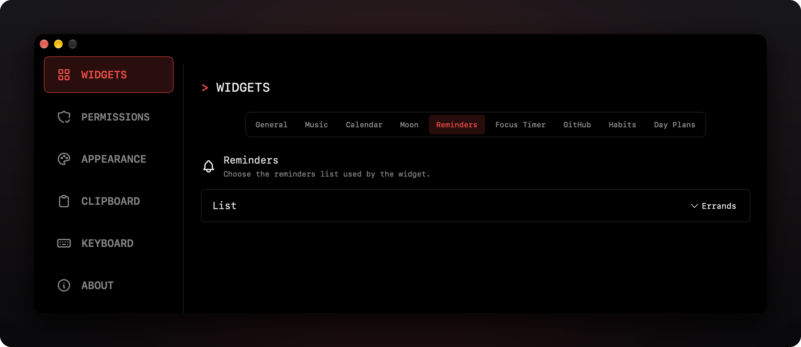

## Install

There is no signed download yet. Build BangBar from source:

1. Install Xcode with the macOS 26.4 SDK or later.
2. Clone the repository and open `BangBar.xcodeproj`.
3. In **Signing & Capabilities** of the `BangBar` target, choose your own team so Xcode can sign the app for your Mac.
4. Build the Release configuration and copy the app to `/Applications`:

   ```sh
   xcodebuild -project BangBar.xcodeproj -scheme BangBar -configuration Release \
     -derivedDataPath build/release build
   ditto build/release/Build/Products/Release/BangBar.app /Applications/BangBar.app
   ```

5. Open BangBar. It lives in the menu bar and has no Dock icon.

To build a disk image instead, run `scripts/build_dmg.sh`. It builds the Release configuration and writes `dist/BangBar-<version>-<build>.dmg`. Set `SIGNING=disabled` to build without a signing identity; Gatekeeper then blocks the first launch until you allow it in System Settings › Privacy & Security.

## Settings

Open Settings from the gear at the top right of the panel or from the BangBar menu bar item.

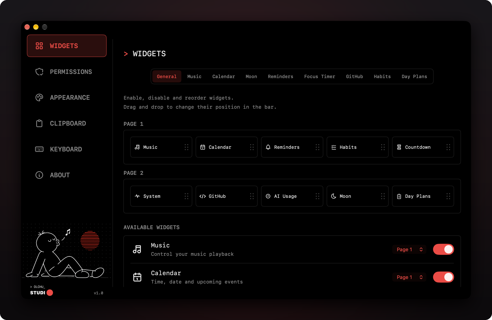

- Widgets: turn widgets on and off, drag them into order, put each on page 1 or page 2, and set per-widget options such as the music player, the calendars, the Reminders list and the GitHub user name.
- Permissions: see each permission BangBar uses and open the matching pane of System Settings.
- Appearance: the accent color and the live activity switches.
- Clipboard: history size and swipe gestures.
- Keyboard: the layout switcher.

### Accent color

One accent color runs through the whole panel: the date, habit marks and progress, the countdown, the focus timer, the page dots, the music placeholder, and the icons and bars of the notch notices. Pick it in Settings › Appearance › Accent color: clicking the swatch opens the macOS color panel, and Reset returns to the default red `#FF383C`. Calendar events keep the colors of their calendars.

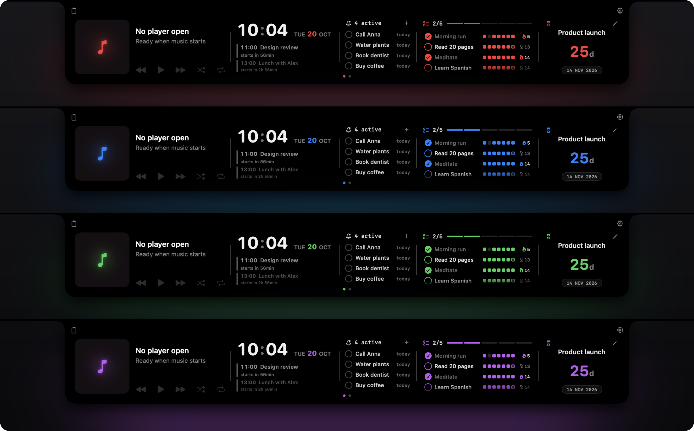

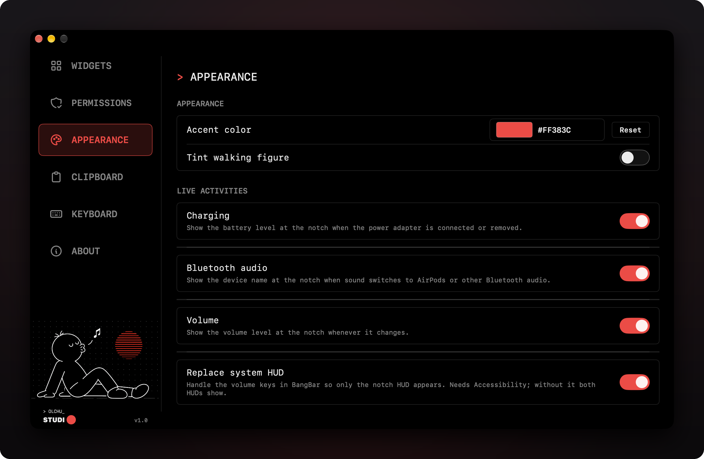

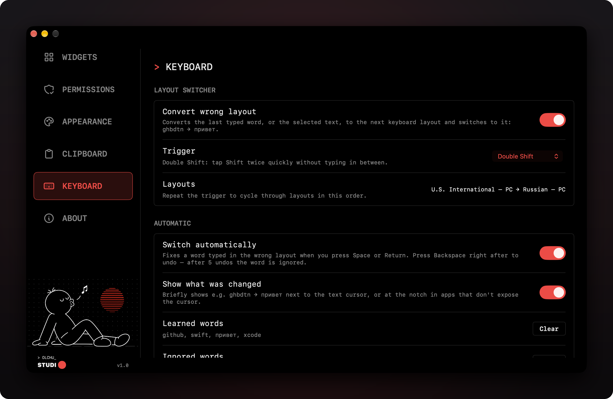

## Permissions

Each permission belongs to the features listed next to it; the rest of BangBar works without it. The Permissions tab in Settings shows what is granted.

| Permission | Used for | Without it |
|---|---|---|
| Automation | Reading and controlling Apple Music and Spotify; reading the tab list of Safari and Chromium browsers for the Now Playing preview | No track details; a browser shows its icon instead of a preview |
| Calendar | Upcoming events in the Clock widget and meeting alerts | No events |
| Reminders | The Reminders widget | No tasks |
| Accessibility | The keyboard layout switcher and taking over the volume keys | No layout switching; the system volume HUD stays |
| System Audio Recording | Live playback bars, and noticing that a browser paused even though its audio stream stays open | Animated bars; the compact strip hides a few seconds later after a pause |
| Camera | The Mirror widget | No mirror |
| Location (optional) | The Moon widget's real orientation in the sky | You type a city instead |

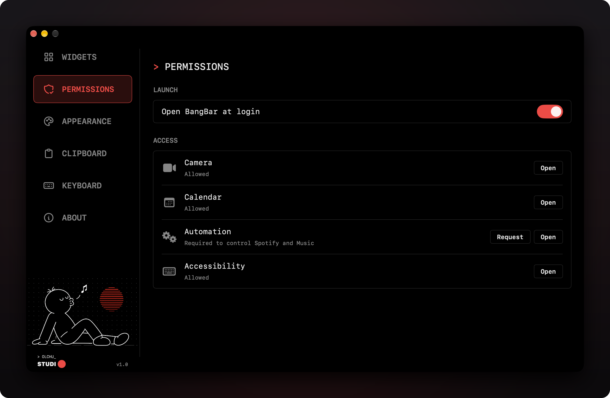

## Privacy

BangBar has no account, no analytics and no server of its own. Data stays on your Mac, with these exceptions, each made only while the feature is on:

| Feature | Request goes to | What is sent |
|---|---|---|
| GitHub widget | `github.com` | The user name you entered; the public contribution graph comes back |
| AI Usage widget | `api.anthropic.com`, `chatgpt.com` | Your own Claude Code and Codex sign-in tokens, read from `~/.claude`, the macOS keychain and `~/.codex`, to fetch your quota |
| Apple Music artwork fallback | `itunes.apple.com` | Track title and artist, when Music has no artwork for the track |
| Browser tab preview | The playing page's own site or its oEmbed endpoint (YouTube, Vimeo, SoundCloud, Spotify, Dailymotion) | The page address, without cookies |

The Translator widget uses Apple's on-device Translation framework.

Clipboard history is stored in `~/Library/Application Support/BangBar/ClipboardHistory`. It skips anything an app marks as private through the [nspasteboard.org](http://nspasteboard.org) convention, which is how password managers mark copied passwords; everything else you copy is kept. There is no switch to turn the history off. **Clear History** in the panel removes everything except pinned items. Day Plans are stored in iCloud Drive under `BangBar/DayPlans`.

## Building and testing

The app target has no third-party dependencies. Unit tests for the pure logic run without Xcode's test runner:

```sh
scripts/test_keyboard_switcher.sh
scripts/test_countdown_formatter.sh
scripts/test_moon_geometry.sh
scripts/test_panel_activation_geometry.sh
```

[`SPEC.md`](SPEC.md) describes the behavior of every feature in detail and is the reference for changes. [`CLAUDE.md`](CLAUDE.md) holds the project conventions.

## License

BangBar is released under the [MIT License](LICENSE). Third-party notices are in [`THIRD_PARTY_NOTICES.md`](THIRD_PARTY_NOTICES.md).

The screenshots use demo data. The video preview in them is *Big Buck Bunny* by the Blender Foundation, licensed under [CC BY 3.0](https://creativecommons.org/licenses/by/3.0/).
